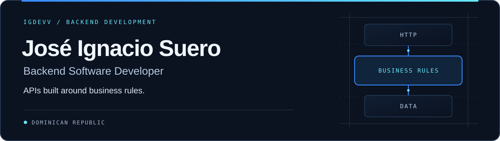

  

I develop, maintain, and improve software used in **clinical laboratory operations and administrative workflows**. Working with these systems has taught me to understand the process behind a requirement and consider how a change affects the people using it.

My focus is backend development: translating business requirements into explicit rules, clear API contracts, and maintainable code.

## Technical stack

| Area | Technologies |
| :--- | :--- |
| Language & framework | C# · .NET 10 · ASP.NET Core |
| APIs & persistence | REST APIs · Entity Framework Core · LINQ |
| Databases | SQL Server · PostgreSQL |
| Version control | Git |

**Currently learning:** Microsoft Azure and Docker.

## Featured projects

Selected personal projects where I put backend concepts into practice.

### [FacturacionAPI](https://github.com/igdevv/FacturacionAPI)

**Internal invoicing, with business rules in the domain.**

A learning project built with ASP.NET Core 10, Clean Architecture, EF Core, and SQL Server. Separate domain, application, infrastructure, and API projects keep business logic apart from HTTP and persistence concerns.

- Customer and product management, stock adjustments, and draft-to-issued invoices.
- Invoice calculations and state transitions enforced by domain entities; invoice lines retain their original unit prices.
- Optimistic concurrency handling, structured HTTP errors, and xUnit tests for domain rules, application behavior, and SQL Server persistence.

[Explore the domain](https://github.com/igdevv/FacturacionAPI/tree/main/FacturacionAPI.Domain) · [Read the tests](https://github.com/igdevv/FacturacionAPI/tree/main/FacturacionAPI.Domain.Tests)

### [TaskNotes API](https://github.com/igdevv/tasknotes-api)

A notes and categories API with ASP.NET Core Identity and JWT authentication. Queries and updates are scoped to the authenticated user, with text and priority filters, pagination, and DTO projections for read operations.

### [SistemasReservas](https://github.com/igdevv/SistemasReservas)

A reservation API organized into domain, application, infrastructure, and HTTP layers. Includes request validation, a check for overlapping time slots before creation, and domain methods for confirming and cancelling reservations.

## Engineering focus

Areas I work on, practice, and continue to deepen:

- **Domain modeling** — putting validation, calculations, and state transitions close to the data they govern.
- **Application design** — applying SOLID principles and dependency injection to keep responsibilities clear and dependencies explicit.
- **API contracts** — designing request and response models, access rules, and consistent error behavior.
- **Verification** — using automated tests to exercise business rules and persistence behavior, including failure cases.

## Contact

Find me on [GitHub · @igdevv](https://github.com/igdevv).
